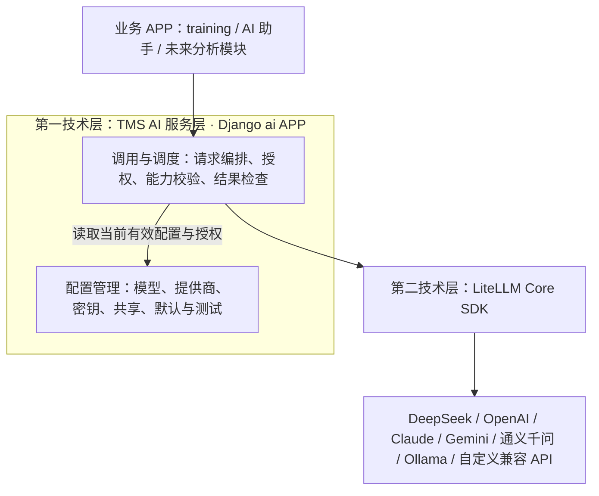

# TMS AI 多模型提供商接入与管理系统——前后端最终设计方案 V1.2

> **文档性质**：业务与技术设计基线（供人审阅，不是代码实施清单）
> **日期**：2026-11-14
> **代码基线**：[hdaojin/tms · develop](https://github.com/hdaojin/tms/tree/develop)；本次审阅的 Git tree SHA：`2193b848ec59a90512453c60402e1a5c5b5f6252`。实施时以 `develop` 最新实际代码复核。
> **状态**：经讨论确认的目标方案；实施前仍需先完成数据库升级演练。

## 1. 设计目标与关键决定

本次建设不是另起一个 AI 平台，而是把现有 DeepSeek 专用模型接入改造为 TMS 全局 AI 基础能力。目标是统一管理多提供商模型，支持用户自定义 OpenAI 兼容 API，保持现有用户权限、共享、凭据保护、训练日志生成与历史数据，支持后续 AI 助手、评分分析等业务直接复用。

**最终定案：两层技术架构、三个职责模块、一个 Django APP、三个前端管理入口。**

| 项目 | 最终决定 |
|---|---|
| Django APP | 从 `ai_models` **彻底迁移**为 `ai`，包括 Python 包、Django app label、数据库实体、权限与内部路由命名空间 |
| 第一技术层 | TMS AI 服务层（自主开发） |
| 第二技术层 | LiteLLM Core SDK 接入适配层（Python 库，运行在 Django 进程内） |
| 三个职责模块 | 模型调用与调度；模型配置管理；模型接入适配 |
| 多模型接入 | LiteLLM 原生支持的厂商 + 一种自定义 OpenAI 兼容入口 |
| 独立网关 | 不部署 LiteLLM Proxy；不引入 Dify、Open WebUI、LangChain 等完整平台 |
| 数据建模 | V1 不拆分 `AIConnection`；沿用单条 `AIModel` 保存一组模型配置、地址、凭据 |
| 模型选择 | 显式指定或使用用户默认模型；不自动切换到其他厂商 |
| 现有系统 | 保留模型验证、Fernet 加密、默认模型、共享管理、训练日志业务语义 |

LiteLLM 不是用户界面和权限管理的替代品。它负责各种提供商的调用、常见参数与响应适配；TMS 负责“哪些模型能由谁配置和使用”及“本次业务的输出是否合格”。“OpenAI 兼容 API”仅是第三方接口协议，**不是**需要独立部署的组件。

## 2. 系统架构与业务边界



此图表示**逻辑依赖**，不是网络中的三个代理服务。`ai` APP 对外提供唯一的统一调用接口，不让 `training` 直接引用 LiteLLM 或厂商 SDK。

### 2.1 调用与调度模块

- 接受标准化任务请求，解析用户显式模型或默认模型；对模型所有者、共享范围和配置版本重新授权。
- 依据模型能力校验本次所需文本/图片/JSON/思考参数；构建统一请求和超时、输出限额策略。
- 将可执行请求下发接入适配层；对返回进行非空、截断、JSON 格式及业务 Schema 校验。
- 将安全、可解释的错误反馈给业务层，关键数据不得静默丢弃。
- V1 不包含智能模型选路、负载均衡、跨模型失败回退或多租户计费。

### 2.2 模型配置管理模块

- 系统提供商目录和默认配置；管理员维护推荐模型及可选参数。
- 用户独立的模型记录、API 地址和加密密钥、验证状态、设置为默认。
- 私有、全体共享、按用户/角色定向共享，管理员下架与恢复。
- 权限由 Django Permission + TMS 原有共享业务规则决定，不因使用 LiteLLM 而改变。

### 2.3 LiteLLM 接入适配模块

- 统一调用外部厂商的原生 API 或 OpenAI 兼容接口；接受 TMS 传入的每次请求专用凭据与目标地址。
- 对参数进行服务商映射，提供统一响应对象和错误分类。
- 不维护 TMS 账号权限、共享范围、数据库配置或任务特有的 JSON 语义。
- 避免运行中修改 `litellm.api_key`、全局 callbacks、全局缓存等进程级状态；不将密钥记录到日志。

## 3. 数据与提供商设计

### 3.1 V1 模型沿用

| 最终 ORM 对象（都在 `ai` APP） | 沿用原模型 | 职责 |
|---|---|---|
| `AIModel` | `ai_models.AIModel` | 用户模型、模型 ID、实际 Base URL、加密密钥、思考参数、验证、共享等 |
| `AIProviderSettings` | 同名 | 默认地址、默认参数、提供商级管理配置 |
| `AIModelOption` | 同名 | 推荐模型 ID、显示名称、是否启用、默认项 |
| `AIModelPreference` | 同名 | 用户默认模型 |

继续保留已有 `revision`、`verified`、`test_*`、`shared_users`、`shared_groups` 等字段与既有业务规则。模型名称等纯展示字段变更无需撤销验证；更改接入地址、提供商、模型 ID、密钥、影响实际调用的参数或能力设置，应更换版本、失效旧验证、暂停共享，保存后重新手动测试。

**彻底改名的含义**：新代码以 `ai.apps.AIConfig`、`AppConfig.name='ai'`、`AppConfig.label='ai'` 为准；新数据库表使用 `ai_` 前缀，权限字符串为 `ai.view_aimodel` 等，URL namespace 为 `ai`。`/ai-models/` 可以保留为稳定的浏览器访问路径——URL 路径与 Django APP 名称无须相同。升级脚本允许为识别历史数据出现旧标识，但业务运行时不得依赖旧 APP。

### 3.2 提供商注册

系统内置用户可选择的提供商包括 DeepSeek、OpenAI、Anthropic、Gemini、阿里云百炼/通义千问、OpenRouter、Ollama（自托管）和“自定义（OpenAI 兼容）”。具体 LiteLLM `model` 前缀和 `api_base` 规则以项目锁定版本的官方文档与实际探测为准，**不得由用户自由输入 LiteLLM 内部路由前缀**。

提供商注册声明建议包含：`code`、显示名称、默认地址、`litellm_provider`（内部可信常量）、认证类型、是否允许覆盖地址、推荐模型、能力预设和启用状态。注册表属于代码支持的能力；管理员只维护可运行时改变的默认值与目录，不允许数据库创建“代码未支持的新协议”。

自定义 OpenAI 兼容 API 的调用模式由 TMS 固定映射为适当 LiteLLM 兼容接入类型；用户只能编辑其实际 `base_url`、`model_id` 和允许的认证字段。

### 3.3 模型能力

V1 采用 **TMS 已验证设置 / 管理员可信预设 / LiteLLM 参考元数据 / 保守默认** 的综合策略。模型能力属于模型级，而不是简单根据提供商判断：

| 能力 | V1 规则 |
|---|---|
| 文本生成 | 基础连接测试成功才可用 |
| 图片输入 | 需确认当前模型/接口支持，不能对所有同厂商模型开放 |
| JSON 输出 | 请求能力匹配，结果必须由 TMS 严格解析和业务校验 |
| 思考模式/强度 | 根据模型实际支持的值显示和转换，不强行套用 DeepSeek 的 `thinking` |
| 工具调用、流式输出 | 设计上预留，V1 不开放完整业务功能 |

未知能力默认禁用，后续通过专门测试或管理员核准开启；禁止自动静默忽略影响训练日志正确性的必需参数。

## 4. 前端信息架构

保持三个菜单入口：

| 位置 | 名称 | 用户群 |
|---|---|---|
| 用户中心 | 我的 AI 模型 | 具有模型查看/维护/共享使用权限的用户 |
| 系统管理 | AI 模型提供商 | 超级管理员 |
| 系统管理 | 共享 AI 模型管理 | 超级管理员 |

**不设置独立“连接管理”菜单；不提供 LiteLLM 配置页。**

### 4.1 我的 AI 模型列表

- 顶部：页面标题、简短说明、右侧“新增 AI 模型”按钮（仅有权限时）。
- 搜索区：模型名称 / 厂商 / 模型 ID 统一搜索；“全部 / 我的 / 共享”切换；提供商、验证状态、共享状态筛选。复用既有 TMS 搜索筛选布局规范。
- `django-tables2` 表格列：模型名称（副标题为 ID）、提供商、所有者、当前验证、共享范围、默认标识、操作；支持排序、分页。
- 默认项使用星标/“默认模型”说明；不允许仅凭最近测试失败就自动撤销已有 verified，需区分 **配置是否已验证** 与 **最近测试结果**。
- 权限控制：共享模型的消费者只能查看公开元信息、设为默认；不得看到密钥、完整测试材料、所有者私人配置编辑入口。
- 空状态：引导新增或提示暂无共享项；移动端减少列并允许必要的横向滚动。

### 4.2 新增 / 编辑 AI 模型表单——最终交互

采用**单页分区表单**，不是分步向导。桌面端主表单宽度建议 760–900px，可在宽屏显示简洁帮助栏；移动端单栏。

**区块 A：基本信息**

| 字段 | 必填 | 默认与交互 |
|---|---|---|
| 模型名称 `name` | 是 | 用户自定义，最大长度沿用后端限制 |
| 模型提供商 `provider` | 是 | 展示精选提供商 + 自定义兼容入口；切换时动态加载目录、默认地址与参数 |

**区块 B：API 连接**

| 字段 | 必填 | 默认与交互 |
|---|---|---|
| `base_url` | 自定义必填；预置可空 | 空则按系统可信默认值解析；地址字段始终显示“留空时的有效地址” |
| `api_key` | 由认证类型决定 | 云厂商一般必填；受控内网无认证 Ollama 可留空。编辑时留空=保留现有密钥，不能回显明文 |

**区块 C：模型设置**

| 字段 | 必填 | 默认与交互 |
|---|---|---|
| 推荐模型选择 | 与手动 ID 二选一 | 默认当前提供商推荐模型；选项由管理员目录生成 |
| `model_id` 手工输入 | 二选一 | 对自定义兼容 API 默认显示；禁止因下拉选择替换已填写的 ID 而无提示 |

**区块 D：高级选项（默认折叠）**

- “思考模式”：使用模型默认 / 关闭 / 开启，仅当支持时提供；不支持时不要展示无效控制。
- “思考强度”：仅在开启且能力支持时显示对应取值；不同厂商的枚举映射由后端处理。
- V1 **不开放** Temperature、任意厂商 JSON 参数、业务最大 Token、超时和重试等易与业务规则冲突的技术选项。
- 底部固定为“取消”“保存模型”。正常保存不自动触发外部 API；成功跳至详情页，主动点击“发起测试”。

**重要的细节**：

1. 切换提供商前如已填写用户值，保留每个提供商的本地草稿或明确提示清空哪些字段，避免静默覆盖。
2. 编辑密钥提供“更换密钥”操作与遮罩，不向浏览器传回原始密钥；更换地址/提供商时要求按安全策略重新输入凭据。
3. 前端交互只提高易用性；所有 provider、URL、模型 ID、能力与权限仍由后端校验。
4. 有效 API 地址应明确区分用户显式值和默认值，避免管理员更新默认地址时悄然改变用户既有连接；沿用当前保存具体有效地址的兼容逻辑。
5. 表单错误应定位字段、保留提交值，具有异步请求时显示加载状态，不重复提交。

### 4.3 详情与测试、共享

详情页分为三块：①模型概览（脱敏）②连接测试（开始、最近结果、耗时、已脱敏请求/回复）③共享设置。顶部集中显示“编辑”“设为默认”“删除”等受权限保护的动作。

- 连接测试为用户主动操作（可能产生费用）；短句固定、超时和响应大小有上限，避免用户输入任意测试 Prompt。
- 通过一次测试≠永久在线；测试失败≠永久撤销已验证状态。实际调用失败需要安全提示。
- 共享前必须验证通过；范围为私有 / 全体 / 定向用户和角色；保留名单、管理员下架与恢复原有语义。
- 共享时告知调用费用与数据发送对象；接收人不能编辑模型或获取凭据。

### 4.4 超级管理员页面

提供商列表：显示名称、接入协议类型、默认地址、推荐模型、启用状态和操作。提供商详情：管理员维护默认地址、模型目录（新增/编辑/隐藏/默认）、能力预设；不允许动态执行用户提交的插件代码。共享管理保持下架与恢复流程。

### 4.5 前端栈规范

Django Forms 服务端验证；`django-tables2` + `django-filter` 统一列表；HTMX 完成模型选项和测试结果局部刷新；Alpine.js 处理表单显示与折叠；Tailwind CSS 4 和 DaisyUI 5 统一布局与组件；Iconify 延用现有 Tabler 图标。避免 Alpine 与 HTMX 同时修改同一 DOM 区域，复用现有 `components/field.html`、`common/form.html`、表单错误组件。

## 5. 后端接口与调用流程

建议在 `ai` 内划分三个代码职责区：

```text
ai/
├── apps.py                       # AIConfig：name='ai', label='ai'
├── models.py / forms.py / views.py / urls.py
├── tables.py / filters.py
├── providers.py / catalog.py    # 提供商注册 + 推荐目录
├── services.py                   # 配置、凭据、共享和权限（兼容现有边界）
├── dispatcher.py                 # 对业务 APP 的统一调用入口
├── llm/
│   ├── client.py                 # LiteLLM Core SDK 最小封装
│   ├── parameters.py             # TMS 标准请求到 LiteLLM 参数
│   └── exceptions.py             # 统一异常与脱敏
├── templates/ai/ ...
├── migrations/ ...
└── tests/ ...
```

以上仅为建议，实施中禁止为目录形式机械拆文件。`training` 等 APP 不直接 import LiteLLM。保留旧 `generate_text(user, model_id, revision, payload)` 的调用兼容期，逐步抽象出稳定的 `generate(...)` 请求/响应接口。

**V1 调用流程**：业务提交 → 选择指定/默认模型 → 验证当前用户权限、当前 `revision`、提供商和模型是否可用 → 解密凭据 → 检查业务所需模型能力 → 请求参数转换 → LiteLLM 调用 → 安全响应校验 → 返回业务。业务必须自行处理任务级 JSON Schema、事实约束和文档存储。不可在请求失败后自动转发到其他 API 地址或提供商。

### 5.1 标准调用参数

`messages`、`thinking`、`reasoning_effort`、`max_output_tokens`、`response_mode`、`images`、`timeout` 等作为内部语义参数，其中是否强制与默认值由业务控制。由接入层转换厂商特有格式。错误返回应区分：认证、余额/额度、限流、模型不存在、协议不兼容、超时、网络错误、输出截断、结构校验失败，禁止泄露上游请求体和密钥。

### 5.2 训练日志兼容

现有 `training/log_generation.py` 构造 `thinking`、`reasoning_effort` 和 `response_format={'type':'json_object'}` 等 DeepSeek 风格参数，且图片能力调用旧 `PROVIDERS[...].supports_images(...)`。改造时需由 `ai` 层接管参数兼容，`training` 仅声明“需要什么”，不能直接访问 LiteLLM 或厂商适配对象。保留原有提示词、教练/选手日志快照、训练资料权限、图片引用和历史生成任务的一致性。必须验证旧 DeepSeek 的文本、思考、JSON、图片场景是否与新层兼容。

## 6. `ai_models` → `ai` 彻底迁移设计

**关键定义：改名不等于重新建表。所有现有用户模型、密钥、关联、授权、历史日志数据及其主键都要保留。** 迁移目标包括：

- Python 包 `ai_models/` → `ai/`，`AppConfig.name/label` 改为 `ai`；所有运行时 import、模板目录和 URL namespace 改为 `ai`。
- 新数据库表名采用 `ai_*` 前缀（包括 `AIModel` 的共享用户/角色中间表）；既有表需原地安全更名，不删表，不丢主键或外键。
- `django_migrations.app` 中旧 APP 的历史记录转为 `ai`；历史迁移 graph 的依赖和关联标签改为 `ai`，包括 `training/migrations/0026_training_log_ai_workflow.py`。
- `django_content_type.app_label` 从 `ai_models` 更新为 `ai`，**保留原 content type 主键**；对应 `auth_permission` 保留主键及组/用户现有多对多关系，运行时权限前缀改为 `ai.`。
- `accounts.UserProfile.selected_permission_bundles` 与 `accounts.GroupProfile.selected_permission_bundles` JSON 数组中的 `ai_models.manage_own` / `ai_models.use_shared` 迁移到 `ai.manage_own` / `ai.use_shared`；保留无关授权，维护投影一致性。
- 更新 `core/config/navigation.yml`、`core/config/permission_bundles.yml`、AGENTS、CONTEXT、README、用户手册及所有业务链接与测试。

**约束**：必须同时证明“全新数据库从零 `migrate`”和“真实旧库快照升级”均通过。因 Django 官方明确警告已应用迁移后修改 `AppConfig.label` 会破坏数据库/迁移关系，所以升级采用**专门的、可审计、经预演的旧库转换步骤**，不能使用 `DeleteModel/CreateModel`、`flush`、盲目 `--fake-initial`、删除原 `django_content_type` 或权限记录。保留迁移前备份与生产停机窗口。详细执行与回滚要求见配套 Codex Plan。

URL 可以继续保留 `/ai-models/` 作为稳定用户路径，但内部必须使用 `ai` namespace；这是刻意保留的公开业务 URL，不意味着 APP 尚未彻底迁移。

## 7. 安全、性能与运维

- Fernet 凭据加密沿用 `AI_MODEL_ENCRYPTION_KEY`，不因 APP 改名自动更换密钥。数据库备份必须与密钥备份对应，且不得在源码/日志保存密钥。
- 自定义 URL 需要 SSRF 策略：协议、目标 IP/域名、DNS 解析与重绑定、代理、重定向、端口、内网访问控制。默认外部 HTTPS；本地 Ollama 按管理员控制的可信网段/服务清单授予权限，不默认允许任意用户访问私网。
- 禁止修改 LiteLLM SDK 的全局凭据；限定请求大小、响应大小、超时、并发与速率；错误信息脱敏；保存、测试、共享各自清晰授权。
- V1 继续使用现有同步任务处理模式，不能悄然引入 Celery/Redis 等新基础设施；现有训练日志生成的任务状态、超时和日志一致性须保留。
- 提供商模型目录不做自动联网发现；管理员维护预置 ID，用户可以手动填写 ID。

## 8. V1 范围、验收与后续

### 必须完成

1. `ai_models` 全部运行时结构及 DB 身份迁移到 `ai`，现有配置、主键、权限、角色包与训练日志关联无损。
2. `litellm-core` 在当前 Python 3.13 / Django 项目依赖下可稳定安装与调用；`litellm` 与 `litellm-core` 不共存。
3. 至少完成 DeepSeek、新增一个原生厂商、自定义 OpenAI 兼容 API 的模拟及（凭据可用时）受控真实连接验证。
4. 用户可以配置、保存、测试模型、设置默认、分享给有权限的对象；全套操作后端授权与脱敏不退化。
5. 训练日志的文本、JSON、思考、图片、已保存与历史快照场景无回归。
6. 新库初始化、旧库升级、迁移图、授权、外键和回滚演练通过，前端响应式、列表与表单工作正常。

### 不纳入 V1

独立 `AIConnection`、LiteLLM Proxy、模型列表自动发现、模型自动负载均衡及跨提供商回退、Token/成本精确账单、多租户预算/配额、任意 HTTP 请求编辑器、统一 Agent 框架、完整流式聊天与工具调用系统。

## 9. 设计依据与参考

- TMS develop：<https://github.com/hdaojin/tms/tree/develop>
- 关键源码：`ai_models/{models,providers,services,forms,views,catalog}.py`、`training/{log_generation,log_ai_forms}.py`、`training/migrations/0026_training_log_ai_workflow.py`、`core/config/{navigation,permission_bundles}.yml`、`accounts/models.py`。
- Django 6.0 AppConfig：<https://docs.djangoproject.com/en/6.0/ref/applications/>
- Django 6.0 Migrations：<https://docs.djangoproject.com/en/6.0/topics/migrations/>
- Django 6.0 ContentTypes：<https://docs.djangoproject.com/en/6.0/ref/contrib/contenttypes/>
- Django 6.0 Auth：<https://docs.djangoproject.com/en/6.0/topics/auth/default/>
- LiteLLM Core：<https://docs.litellm.ai/docs/litellm_core>
- LiteLLM Python SDK：<https://docs.litellm.ai/docs/python_sdk>
- Tailwind CSS 4：<https://tailwindcss.com/docs/installation>
- DaisyUI 5：<https://daisyui.com/docs/install/>
- Alpine.js：<https://alpinejs.dev/start-here>
- HTMX：<https://htmx.org/docs/>

> 本文档可建议归档至仓库 `docs/design/tms-ai-multimodel-design-v1.2.md`；实际目录以项目现有文档规范为准。
